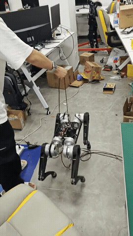
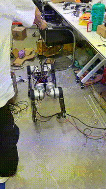

# RCDog-SuperMimic

基于 [Motphys/Uni-SuperMimic](https://github.com/Motphys/Uni-SuperMimic) 的自研12自由度四足机器人运动控制。SuperMimic学习参考动作条件策略，连续参考生成器将手柄指令转换为前进、后退、横移、旋转和停步目标，实机端接入起立、趴下状态机。

当前新增 **V3：flat_legged_a3 / 1000，高抬脚平地实验版**。它采用 [legged_control](https://github.com/qiayuanl/legged_control) 的Go1步态时序及OCS2摆腿样条方法，经RCDog逆运动学生成8 cm抬脚参考；训练仍使用Uni-SuperMimic，没有运行MPC/WBC。旧版权重、演示、参考和报告均保留。

## 效果演示

| V3：新步态，0.5 m/s指令实机表现 | V2：原command150步态实机表现 |
| --- | --- |
| [](docs/assets/rcdog/legged_a3_real050_20261111.mp4) | [](docs/assets/rcdog/rcdog_real_20261110.mp4) |

点击预览查看完整MP4。新视频由作者提供，约19.6秒，现场有人手持扶手跟随；0.5 m/s是作者说明的指令设置，没有同步机身速度或抬脚高度测量。下文仿真结果单独统计。

## 版本分类

| 版本 | 策略与参考 | 状态与入口 |
| --- | --- | --- |
| **V3 / flat_legged_a3** | a3第1000次迭代；8 cm抬脚参考，动态周期0.4～0.6 s，5帧历史；训练物理1 ms | 新实机演示；全速CPU稳定性58/60、步态57/60，尚未全通过；[完整说明](docs/FLAT_LEGGED_A3.md) |
| **V2 / command150** | final500；最高2.5 cm抬脚参考，周期0.32 s，5帧历史；训练物理5 ms | 保留原策略、训练链与报告；[原版首页](https://github.com/coolcooldiyang/RCDog-SuperMimic/tree/v2-command150-final500)、[训练说明](docs/COMMAND150.md) |
| **V1 / omni050–150** | 早期10帧历史的全向策略 | 归档；[使用说明](docs/LEGACY_OMNI150.md) |

版本对应的路径、提交及兼容性见 [版本索引](docs/VERSIONS.md)。V3的训练指令覆盖平移1.5 m/s、旋转1.5 rad/s；公开实机配置默认限制为0.5 m/s、0.5 rad/s。全速失败项和实机停步倾角、USB/UART问题保留在版本说明中。

## 目录

```text
src/unisupermimic/                         Uni-SuperMimic训练框架与RCDog适配
  assets/robots/rcdog/                     11.1134kg RCDog MJCF与网格
  assets/motions/rcdog_flat_legged/        V3的68段CSV及独立相位/接触侧文件
  assets/motions/rcdog/                    V2参考动作，保留
source/                                   作者CAD导出的URDF与STL
experiments/flat_legged_a3/                V3参考构建、训练、CPU仿真、步态评估与导出
experiments/command150/                    V2训练与仿真入口，保留
results/flat_legged_a3/                    V3的a0/a2/a3权重、训练配置、成功与失败报告
results/command150/                        V2的final500及父策略，保留
real_deploy/policies/                      按版本分开的ONNX/TorchScript配套部署包
real_deploy/controller/                    通信、手柄、起立趴下、日志与离线测试
```

## 安装

以下命令均从仓库根目录执行。CPU仿真与ONNX推理不需要GPU或ROS：

```bash
git clone https://github.com/coolcooldiyang/RCDog-SuperMimic.git
cd RCDog-SuperMimic
python3 -m venv .venv-sim
source .venv-sim/bin/activate
python -m pip install -r experiments/flat_legged_a3/requirements-sim.txt
python real_deploy/verify_bundle.py \
  --bundle real_deploy/policies/newurdf_legged_a3_1000
```

训练使用Linux、CUDA GPU和 [uv](https://docs.astral.sh/uv/)：

```bash
uv sync
uv pip install scipy onnx onnxruntime
```

云端训练的依赖快照见 [requirements-training-snapshot.txt](experiments/flat_legged_a3/requirements-training-snapshot.txt)。根目录锁文件沿用框架环境；实际V3训练配置与依赖另行归档。

## 手柄或键盘sim2sim

使用已发布的V3 ONNX，默认0.5 m/s、0.5 rad/s：

```bash
python experiments/flat_legged_a3/sim2sim_gamepad.py
# 没有手柄：
python experiments/flat_legged_a3/sim2sim_gamepad.py --keyboard-only
```

手柄：`LB+A`起立、`RB+Y`接入策略、左摇杆平移、右摇杆旋转、`B`趴下。键盘：`1`起立、`2`接策略、`W/S/A/D`平移、`Q/E`旋转、空格清零、`B`趴下。键盘速度保持至空格清零。

V3回中时当前帧根速度参考置零，步态相位、历史与航向不重置，最后的摆腿幅度约0.3秒收束；指令归零不等于实物瞬时停止。添加 `--cap 1.5` 可在仿真中检查全速实验范围。此入口不打开电机串口。

## 参考动作与训练

仓库已包含预计算参考表和68段动作。修改步态时才需重新构建：

```bash
python experiments/flat_legged_a3/build_legged_reference.py
python experiments/flat_legged_a3/prepare_flat_motions.py
uv run python experiments/flat_legged_a3/validate_flat_reference.py
```

输出为 `experiments/flat_legged_a3/reference_candidates/legged_control/command_gait_table.npz`、`flat_clips.json` 和 `src/unisupermimic/assets/motions/rcdog_flat_legged/`。参考按Go1普通trot（0.6 s、占空比0.5）与flying trot（0.4 s、占空比0.375）插值；8 cm是参考高度上限，极低足速会缩小幅度；本次0.5m/s平移CPU完整摆腿约7.4～7.8cm，0.5rad/s纯旋转约4.7～4.9cm。实机视频没有高度测量。

当前选中训练链为 **V2 final500 → a0 → a2 → a3**。a1和a4未采用；其评估报告仍保留。重训对应阶段：

```bash
uv run python experiments/flat_legged_a3/train.py --stage a0 \
  --parent results/command150/ckpt_000500.pt
uv run python experiments/flat_legged_a3/train.py --stage a2 \
  --parent runs/flat_legged_a0/ckpt_005000.pt
uv run python experiments/flat_legged_a3/train.py --stage a3 \
  --parent runs/flat_legged_a2/ckpt_001500.pt
```

a0/a2/a3分别训练5000/1500/1000次，学习率为1e-4/2e-5/1e-5，512个环境。加载父策略网络权重，重新建立优化器与回放缓冲。输出在 `runs/flat_legged_<stage>/`；同名目录拒绝覆盖，可用 `--name`指定新目录。加 `--smoke`做两次小规模GPU迭代，或 `--print-command`仅检查命令。

关节侧Kp20、Kd0.5，物理1 ms、策略50 Hz、5帧历史、动作比例0.25；髋/大腿位置目标变化率上限30.1 rad/s，小腿15.05 rad/s，反馈速度不截断。a2/a3奖励包含支撑脚及贴地滑移、横向跑偏、摆腿高度不足、倾角和停步抖动；a3将20%重置样本分给失败动作族，80%保留普通自适应采样。actor不使用视觉或地形扫描。

## CPU评估与导出

全方向、多速度、停步及0/8 ms延迟噪声测试；第一条生成逐帧NPZ，第二条据此测量实际摆腿与触地滑移：

```bash
python experiments/flat_legged_a3/evaluate_stability.py \
  --checkpoint real_deploy/policies/newurdf_legged_a3_1000/actor_fp32.onnx \
  --output outputs/flat_legged_a3/stability.json --cap 1.5 --stress
python experiments/flat_legged_a3/evaluate_flat_gait.py \
  --stability-report outputs/flat_legged_a3/stability.json \
  --output outputs/flat_legged_a3/gait.json
```

| 候选 | 稳定性 | 实际步态 | 选择 |
| --- | --- | --- | --- |
| a0 / 5000 | 60/60 | 53/60 | 保留父策略 |
| a1 / 2500 | 33/60 | 33/60 | 拒绝，过强滑移惩罚导致退化 |
| a2 / 1500 | 57/60 | 53/60 | a3父策略 |
| **a3 / 1000** | **58/60** | **57/60** | 本次实机演示候选，实验状态 |
| a4 / 1500 | 58/60 | 53/60 | 未采用 |

a3剩余：无延迟左后斜向滑移、8 ms噪声下右横移关节越速，以及左转停步目标摆幅超限。0.5档实际部署链测试22/22通过，是另一组仿真，不代表全速验收。原始结果见 [VERSION.json](results/flat_legged_a3/VERSION.json) 和 [reports/](results/flat_legged_a3/reports/)。

导出配套包：

```bash
uv run python experiments/flat_legged_a3/export_bundle.py \
  --checkpoint results/flat_legged_a3/a3/ckpt_001000.pt \
  --output outputs/flat_legged_a3_export
```

包内包含ONNX、TorchScript、固定输入、步态表与生成器、离线模型、来源及接口契约。部署时同时使用位置目标限速和实际应用的previous_action，不能只替换actor。

## 实机部署与版本选择

使用GO-M8010-6、宇树USB四路485、HI12M0-MI1-000和ShanWan手柄。每腿ID1/2/3对应髋/大腿/小腿；UART1/2/3/4对应左前/右前/左后/右后。电机内部减速6.33:1，小腿另有2:1皮带传动。

完整安装与标定见 [实机部署](real_deploy/README.md)，常用操作见 [COMMANDS.md](real_deploy/COMMANDS.md)。在控制器目录生成对应版本的本机配置：

```bash
cd real_deploy/controller
python tools/configure_ports.py --policy legged-a3
# 使用旧V2时选择 --policy command150；已有配置不会自动覆盖。
./dognew serve --gamepad
```

另一个终端进入同一目录，从原标定趴姿开始：

```bash
./dognew init-lie &&
./dognew stand &&
sleep 8 &&
./dognew servo-check &&
./dognew arm-walk
```

实机回中给零速度并保持策略，`B`或 `./dognew lie`趴下。公开版默认0.5档；1.5档仍为实验范围。已有实机日志记录了USB公共链路断联、右后UART4超时，以及回中后倾角增长，尚未完成全部硬件与停步问题的修复。

## 来源与许可

- 训练框架：[Motphys/Uni-SuperMimic](https://github.com/Motphys/Uni-SuperMimic)，原始方法 [SuperMimic](https://supermimic.github.io/)。保留上游历史与许可。
- 新步态方法：[qiayuanl/legged_control](https://github.com/qiayuanl/legged_control) 的Go1配置与 [OCS2](https://github.com/leggedrobotics/ocs2) 的SplineCpg；BSD-3-Clause。来源、固定提交和副本见 [reference_candidates](experiments/flat_legged_a3/reference_candidates/legged_control/)。这些是轨迹方法适配，没有下载Go1实录或MPC rollout。
- 通信：[Unitree Actuator SDK](https://github.com/unitreerobotics/unitree_actuator_sdk)，BSD-3-Clause；固定版本的安装与释放GIL绑定补丁保留。
- RCDog模型、生成参考、权重和实机视频由本项目提供。组合软件许可及各资产范围见 [THIRD_PARTY.md](THIRD_PARTY.md)、[NOTICE](NOTICE)、[LICENSES/](LICENSES/)。
