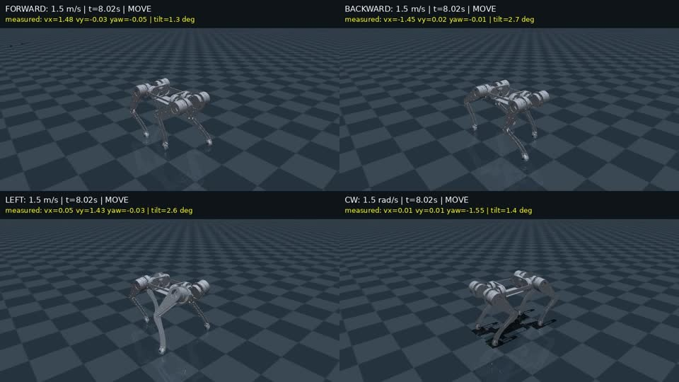

# RCDog-SuperMimic

基于 [Motphys/Uni-SuperMimic](https://github.com/Motphys/Uni-SuperMimic) 的自研12自由度四足机器人运动控制。使用 SuperMimic 可微世界模型训练参考动作条件策略，通过连续参考生成器接收手柄速度指令，实现前进、后退、横移和旋转，并接入实机起立、趴下状态机。

当前版本为 **command150 / final500**：新URDF总质量 **11.1134 kg**，策略 **50 Hz**，电机指令 **200 Hz**，关节侧 **Kp=20、Kd=0.5**，5帧观测历史。平移指令合速度上限 **1.5 m/s**，旋转上限 **1.5 rad/s**。

## 效果演示

| 实机：地面手柄测试 | 仿真：前进、后退、横移、旋转与停步 |
| --- | --- |
| [](docs/assets/rcdog/rcdog_real_20261110.mp4) | [](docs/assets/rcdog/command150_mujoco.mp4) |

点击预览查看完整MP4。实机视频约23秒，现场有人持扶手跟随；没有同步速度测量。下文的速度与通过率来自仿真评估。

## 目录

```text
src/unisupermimic/
  rl/algos/supermimic/                     世界模型、策略、critic和训练循环
  tasks/motion_tracking/rcdog/supermimic/   RCDog观测、奖励、传动与动力学配置
  assets/robots/rcdog/                     当前URDF转换的MJCF与网格
  assets/motions/rcdog/                    速度、旋转、对角与启停参考动作
source/                                   当前CAD导出的URDF与STL
experiments/command150/                    参考生成、训练、导出、CPU MuJoCo与手柄仿真
results/command150/                        final500权重、父策略、训练配置和评估记录
real_deploy/policies/newurdf_command150_final500/
                                          ONNX、TorchScript、参考表与接口契约
real_deploy/controller/                    实机通信、起立趴下、手柄、IMU与日志
real_deploy/README.md                      实机安装、标定与运行步骤
real_deploy/COMMANDS.md                    常用命令与故障排查
```

早期 `omni050 / omni100 / omni150` 的权重和报告保留在原目录。它们使用10帧历史，不能与当前5帧部署程序混用；对应代码见 [早期版本说明](docs/LEGACY_OMNI150.md)。

## 安装

克隆后，以下仿真和训练命令均在仓库根目录执行：

```bash
git clone https://github.com/coolcooldiyang/RCDog-SuperMimic.git
cd RCDog-SuperMimic
```

只运行ONNX策略与CPU MuJoCo，不需要GPU或ROS：

```bash
python3 -m venv .venv-sim
source .venv-sim/bin/activate
python -m pip install -r experiments/command150/requirements-sim.txt
python real_deploy/verify_bundle.py \
  --bundle real_deploy/policies/newurdf_command150_final500
```

训练使用Linux、CUDA GPU、Python 3.10–3.13和 [uv](https://docs.astral.sh/uv/)。按框架环境安装：

```bash
uv sync
uv pip install scipy onnx onnxruntime
```

训练机的完整依赖记录见 [requirements-training.txt](experiments/command150/requirements-training.txt)；它是环境快照，CPU仿真使用上面的独立依赖文件。

## 手柄与键盘仿真

直接使用发布的ONNX，无需先训练：

```bash
python experiments/command150/sim2sim_gamepad.py
```

仿真手柄：`LB+A` 起立，`RB+Y` 接入策略，左摇杆平移、右摇杆旋转，`B` 趴下。键盘：`1` 起立、`2` 接策略、`W/S/A/D` 平移、`Q/E` 旋转、空格停止、`B` 趴下。键盘速度指令会保持至空格清零。

没有手柄时：

```bash
python experiments/command150/sim2sim_gamepad.py --keyboard-only
```

仿真只打开MuJoCo与输入设备，不打开电机串口。不要让实机后台和仿真同时读取同一个手柄。

## 参考动作与训练

仓库已包含当前模型和72段训练参考。参考由足端轨迹经RCDog逆运动学生成，速度网格覆盖前后、左右与旋转，另有静止、方向切换和对角动作；没有使用第三方动作捕捉数据。

重建参考表和CSV：

```bash
python experiments/command150/build_references.py
```

输出为 `experiments/command150/command_gait_table.npz`、`plan.json` 和 `src/unisupermimic/assets/motions/rcdog/*.csv`。当前参考周期0.32秒、占空比0.5、最大抬脚高度0.025米，面向平地运动。

当前训练链从仓库内的横移父策略开始，先扩展前后速度，再做全向速度跟踪与停步微调：

```bash
# 前后速度扩展到1.0 m/s；继承父策略的横移、旋转能力
uv run python experiments/command150/train.py --stage mid \
  --parent results/command150/parent_lateral150.pt

# 前后速度扩展到1.5 m/s
uv run python experiments/command150/train.py --stage high \
  --parent runs/command150_mid/ckpt_000750.pt

# 全向速度跟踪和停步微调
uv run python experiments/command150/train.py --stage final \
  --parent runs/command150_high/ckpt_002000.pt
```

每阶段输出在 `runs/command150_<stage>/`。训练使用1024个并行环境、世界模型 `[512,512,512]`、策略网络 `[512,256,128]`、5帧历史、动作比例0.25。`--parent` 加载网络权重，优化器与经验缓冲重新建立。已有同名目录时拒绝覆盖，可用 `--name` 指定新目录。

正式训练前可加 `--smoke` 跑2次小规模迭代，或加 `--print-command` 只检查命令。奖励中包含机身倾斜、横滚/俯仰角速度，以及零速时的关节速度、动作变化和机身速度惩罚。

发布权重选取最后微调的第500次迭代：`results/command150/ckpt_000500.pt`。第750次候选在连续混合指令测试中后退横向漂移超限，因此未采用。训练配置与选择记录见 [训练与结果说明](docs/COMMAND150.md)。

## sim2sim评估

独立CPU MuJoCo使用1 ms物理步长、50 Hz策略；测试不固定机身，不施加辅助支撑力。全方向、多速度与8 ms延迟/观测噪声测试：

```bash
python experiments/command150/evaluate_stability.py \
  --checkpoint real_deploy/policies/newurdf_command150_final500/actor_fp32.onnx \
  --output outputs/command150/recheck.json --cap 1.5 --stress
```

连续启停、换向和旋转测试：

```bash
python experiments/command150/evaluate_mixed.py \
  --checkpoint real_deploy/policies/newurdf_command150_final500/actor_fp32.onnx \
  --output outputs/command150/mixed.json --delay 8 --noise
```

报告保存速度误差、倾角、停步关节抖动和保护原因；同目录生成逐帧NPZ。发布时的结果为 **60/60** 个CPU MuJoCo案例、**14/14** 个电机传动仿真案例通过，以及 **98.6秒** 连续混合指令测试通过，详见 [VALIDATION_SUMMARY.json](results/command150/VALIDATION_SUMMARY.json)。

| 指令 | 无延迟仿真实测 | 8 ms延迟与噪声仿真实测 |
| --- | --- | --- |
| 前进1.5 m/s | 1.490 m/s | 1.481 m/s |
| 后退−1.5 m/s | −1.469 m/s | −1.491 m/s |
| 左移1.5 m/s | 1.468 m/s | 1.474 m/s |
| 右移−1.5 m/s | −1.465 m/s | −1.467 m/s |
| 左转1.5 rad/s | 1.500 rad/s | 见原始报告 |
| 右转−1.5 rad/s | −1.499 rad/s | 见原始报告 |

导出四格仿真视频：

```bash
MUJOCO_GL=egl python experiments/command150/render_comparison.py \
  --rollout-dir outputs/command150/recheck \
  --output ../../outputs/command150/recheck.mp4
```

当前实机版另加了“摇杆回中立即清零参考”的处理。其专项电机传动仿真为 **10/12通过**，1.5 m/s横移急停在0/8 ms延迟下均触发调试关节速度保护；它与上面的平滑参考评估是两组测试，见 [停步专项记录](results/command150/neutral_continuity_20261110.json)。

## 导出与实机部署

需要重新导出自己训练的checkpoint时，在训练环境执行：

```bash
uv run python experiments/command150/export_bundle.py \
  --checkpoint results/command150/ckpt_000500.pt \
  --output outputs/command150_export
```

输出ONNX/TorchScript、固定输入、参考表、参考生成器与接口契约；新权重应配套保留这些文件。

实机使用 **GO-M8010-6** 电机、宇树USB转四路RS-485、HI12M0-MI1-000 IMU与ShanWan手柄。UART1/2/3/4分别连接左前/右前/左后/右后，每腿ID1/2/3分别为髋/大腿/小腿。电机内部减速比6.33:1，小腿另有2:1皮带减速。

完整步骤见 [实机部署](real_deploy/README.md)，日常操作见 [常用命令](real_deploy/COMMANDS.md)。完成SDK安装和本机标定后，控制器内执行：

```bash
cd real_deploy/controller
./dognew serve --gamepad
```

另开终端进入同一目录，原标定趴姿、手柄松键回中后：

```bash
./dognew init-lie &&
./dognew stand &&
sleep 8 &&
./dognew servo-check &&
./dognew arm-walk
```

实机左摇杆平移、右摇杆旋转，回中立即给零速度参考并保持策略；`B` 或 `./dognew lie` 停止策略后趴下。回中指令清零不等于机器人实际速度瞬间归零。

## 来源与许可

- 框架：[Motphys/Uni-SuperMimic](https://github.com/Motphys/Uni-SuperMimic)，保留上游历史、Apache-2.0许可与NOTICE。原始方法：[SuperMimic](https://supermimic.github.io/)。
- 电机通信：[Unitree Actuator SDK](https://github.com/unitreerobotics/unitree_actuator_sdk)，BSD-3-Clause；安装脚本获取固定版本，并对Python绑定应用释放GIL补丁，核心SDK动态库不随本次更新重新打包。
- 训练控制参数参考：[unitree_cpp_deploy](https://github.com/wty-yy/unitree_cpp_deploy/tree/go2)，采用GYM配套的20/0.5与5帧历史；本项目策略由Uni-SuperMimic训练。
- RCDog模型、生成参考、训练权重和实机视频由本项目提供。软件组合按GPL-3.0-only分发，详见 [THIRD_PARTY.md](THIRD_PARTY.md) 与 [NOTICE](NOTICE)。
