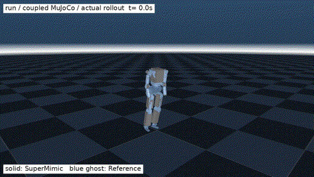
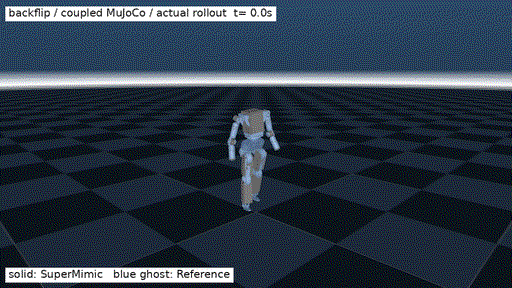

<h1 align="center">RPO-SuperMimic</h1>

<h3 align="center">基于 Uni-SuperMimic 的 RPO 跑步与后空翻动作跟踪</h3>

本项目基于 [Motphys/Uni-SuperMimic](https://github.com/Motphys/Uni-SuperMimic)，将 [SuperMimic](https://supermimic.github.io/) 适配到 RoboParty RPO 23 自由度机器人。训练使用 MJWarp，评估和视频导出使用 MuJoCo；目前包含跑步、后空翻两套独立策略。

| 跑步 | 后空翻 |
| --- | --- |
| [](docs/assets/rpo/rpo_running.mp4) | [](docs/assets/rpo/rpo_backflip.mp4) |

实体机器人由策略控制，蓝色半透明机器人为参考动作。点击 GIF 查看完整 MP4。

## 仓库结构

```text
RPO-SuperMimic/
├── src/unisupermimic/
│   ├── rl/algos/supermimic/             # 世界模型、策略、critic 和训练循环
│   ├── tasks/motion_tracking/rpo/supermimic/
│   │   ├── robot.py, kinematics.py      # 关节顺序、默认姿态、增益和前向运动学
│   │   ├── motion.py, mdp.py            # 参考动作加载、状态和奖励
│   │   ├── parallel.py                 # 并联踝 Jacobian 与电机扭矩限幅
│   │   ├── coupled_backend.py          # 每个物理子步的 PD 与并联踝控制
│   │   ├── evaluate.py, render.py      # 评估与视频导出
│   │   └── env.py, manager_terms.py     # 训练环境
│   ├── conf/supermimic/task/rpo_super_mimic/  # RPO 任务配置
│   ├── assets/robots/rpo/               # MJCF、网格和源 URDF
│   └── assets/motions/rpo/              # 重定向生成的参考动作，不纳入 Git
├── tools/rpo/                          # 重定向、训练与扰动测试脚本
├── results/                            # 已完成实验的配置、日志与评估记录
├── docs/assets/rpo/                    # GIF、MP4 和动作截图
├── docs/REPRODUCE.md                    # 续训、参数说明与常见问题
└── requirements-tested-cloud.txt        # 训练环境的依赖版本记录
```

## 安装

本次使用 Linux、Python 3.12 和 RTX 4090 24 GB。主要依赖版本：

| 依赖 | 版本 |
| --- | --- |
| PyTorch | 2.14.1，CUDA 13.0 构建 |
| UniLab / UniSim Core | 1.5.1 / 2.1.1 |
| MuJoCo / MuJoCo Warp | 3.11.0 / 3.11.0 |
| Warp | 1.16.0 |

```bash
git clone https://github.com/coolcooldiyang/RPO-SuperMimic.git
cd RPO-SuperMimic

python3.12 -m venv .venv
source .venv/bin/activate
python -m pip install --upgrade pip
python -m pip install -e . -c requirements-tested-cloud.txt scipy osqp
```

`requirements-tested-cloud.txt` 用作依赖版本约束；上游 `uv.lock` 保留原样。以下命令均在仓库根目录、激活 `.venv` 后执行。MJWarp 训练需要 NVIDIA GPU，`CUDA_VISIBLE_DEVICES=0` 按自己的 GPU 编号修改。

## 准备动作数据

RPO 模型和网格已包含在仓库中。参考动作与训练权重未随仓库分发，数据使用条款见 [来源与许可](THIRD_PARTY.md)。

| 动作 | 来源文件 | 处理方式 |
| --- | --- | --- |
| 跑步 | [Lafan1_retarget：g1/run1_subject2.csv](https://github.com/wenconggan/Lafan1_retarget/blob/57e5a1921417bf826697f87ba33adb248d4d177f/g1/run1_subject2.csv) | 30 Hz，截取原始帧 4110:4350，右端不含 |
| 后空翻 | [chunwan-flip：90_19_stageii_unitree_g1.csv](https://github.com/lez666/chunwan-flip/blob/c493a897f2ca81153e980a65ee6f0faf7cb07487/data/90_19_stageii_unitree_g1.csv) | 30 Hz，使用完整动作 |

取得相应数据使用许可后，将两个文件放到本地：

```text
data/source/
├── run1_subject2.csv
└── 90_19_stageii_unitree_g1.csv
```

执行 G1 → RPO 重定向：

```bash
python tools/rpo/retarget_public_motions.py \
  --run-source data/source/run1_subject2.csv \
  --backflip-source data/source/90_19_stageii_unitree_g1.csv
```

脚本按 RPO 关节范围做 IK，保持源动作的足部净空，再进行时间平滑和并联踝电机转速约束，输出：

```text
src/unisupermimic/assets/motions/rpo/
├── run_reference.csv           # 399 帧，50 Hz
├── run_reference.json          # 重定向参数与数据哈希
├── backflip_reference.csv      # 431 帧，50 Hz
└── backflip_reference.json
```

CSV 每帧 30 列：根部位置 `XYZ`、根部四元数 `XYZW`、23 个关节角（rad）。关节顺序见 [robot.py](src/unisupermimic/tasks/motion_tracking/rpo/supermimic/robot.py)。后空翻的原始数据经 CMU / AMASS → GMR → G1，本仓库完成 G1 → RPO 这一步。

## 训练

训练分为两步：先用独立执行器模型训练基线，再加载基线权重，使用并联踝电机模型微调。跑步和后空翻分别训练。

### 1. 训练基线

```bash
CUDA_VISIBLE_DEVICES=0 bash tools/rpo/train_rpo.sh run 6000 independent
CUDA_VISIBLE_DEVICES=0 bash tools/rpo/train_rpo.sh backflip 5000 independent
```

输出分别位于 `runs/rpo_run_v1/` 和 `runs/rpo_backflip_v1/`。

### 2. 准备微调权重

```bash
mkdir -p initializers
cp runs/rpo_run_v1/last.pt initializers/rpo_run_v1_last.pt
cp runs/rpo_backflip_v1/last.pt initializers/rpo_backflip_v1_last.pt
```

### 3. 并联踝模型微调

```bash
CUDA_VISIBLE_DEVICES=0 bash tools/rpo/train_rpo.sh run 2500 coupled
CUDA_VISIBLE_DEVICES=0 bash tools/rpo/train_rpo.sh backflip 2500 coupled
```

脚本读取 `initializers/` 中对应的基线权重。微调重新建立优化器和采样缓冲区，迭代编号从头开始；新增的执行器模型在每个 4 ms 物理子步计算 PD，将并联踝电机扭矩限制在 ±27 Nm 后映射回关节。

| 参数 | 本次设置 |
| --- | --- |
| 每个动作的并行环境数 | 1024 |
| 世界模型隐藏层 | `[1024, 1024, 1024]` |
| 策略隐藏层 | `[1024, 512, 256, 128]` |
| 历史观测 / 未来参考 | 10 帧 / 10 帧 |
| 物理步长 / 控制周期 | 4 ms / 20 ms |
| checkpoint 间隔 | 500 iterations |

微调输出分别位于 `runs/rpo_run_v2/` 和 `runs/rpo_backflip_v2/`。每个目录包含：

```text
ckpt_002500.pt      # 指定迭代的世界模型和策略权重，用于评估/视频
last.pt             # 含优化器等状态，用于中断后续训
run_config.json     # 完整训练配置
policy_contract.json # 策略输入输出与资产配置
train_log.csv       # 训练日志
```

续训命令与参数修改方法见 [续训与参数说明](docs/REPRODUCE.md)。

## 评估

评估从参考动作首帧开始，关闭观测和动作噪声，执行完整动作。入口会读取 checkpoint 同目录的配置与策略契约。

```bash
# 跑步
python -m unisupermimic.tasks.motion_tracking.rpo.supermimic.evaluate \
  --backend mujoco \
  --ckpt runs/rpo_run_v2/ckpt_002500.pt

# 后空翻
python -m unisupermimic.tasks.motion_tracking.rpo.supermimic.evaluate \
  --backend mujoco \
  --ckpt runs/rpo_backflip_v2/ckpt_002500.pt
```

终端输出 `norm_return`（归一化回报）和 `n_failed`（失败动作数）。如需测试初始姿态和速度扰动：

```bash
python tools/rpo/evaluate_trials.py \
  --ckpt runs/rpo_backflip_v2/ckpt_002500.pt \
  --trials 8 --scale 0.15 \
  --output outputs/backflip_acceptance.json
```

测试跑步时，把 checkpoint 路径改为 `runs/rpo_run_v2/ckpt_002500.pt`。扰动范围与通过条件见 [扰动测试](docs/REPRODUCE.md#扰动测试)。

## 视频导出

```bash
# 跑步
MUJOCO_GL=egl python -m unisupermimic.tasks.motion_tracking.rpo.supermimic.render \
  --backend mujoco \
  --ckpt runs/rpo_run_v2/ckpt_002500.pt \
  --clip run_reference --seconds 8 --global-ghost \
  --output outputs/rpo_running.mp4

# 后空翻
MUJOCO_GL=egl python -m unisupermimic.tasks.motion_tracking.rpo.supermimic.render \
  --backend mujoco \
  --ckpt runs/rpo_backflip_v2/ckpt_002500.pt \
  --clip backflip_reference --seconds 8.6 --global-ghost \
  --output outputs/rpo_backflip.mp4
```

默认输出 960×540、25 fps 的 MP4。`--global-ghost` 保留参考动作的全局位移；去掉该参数，参考动作的 XY 会对齐策略，便于比较姿态。

## 结果

两套策略均选取并联踝微调阶段的 `ckpt_002500.pt`。MuJoCo 评估结果：

| 动作 | 归一化回报 | 动作表现 | 初始扰动测试 |
| --- | ---: | --- | ---: |
| 跑步 | 0.8905 | 约 8 秒前进 7.49 m | 8/8 |
| 后空翻 | 0.7182 | 完成翻转，落地后蹲姿收稳 | 8/8 |

配置、训练日志和评估记录位于 [results/](results/)。这两套策略跟踪固定参考动作，跑步尚不支持摇杆速度指令，后空翻尚不包含起身。踝电机瞬时转速仍会超过 URDF 标称 8 rad/s，目前未接入实机。

## 来源与许可

- **训练框架**：[Motphys/Uni-SuperMimic](https://github.com/Motphys/Uni-SuperMimic)，基线提交 `faf7818e8abac3ec6abb8f00e6e904d3577f800b`；上游 [中文说明](README.upstream_zh.md)。
- **原始方法**：[SuperMimic](https://supermimic.github.io/)，Qiayuan Liao 等，[*SuperMimic: Scaling Humanoid Whole-Body Control with One Differentiable World Model*](https://arxiv.org/abs/2610.28480)。
- **机器人与并联踝**：[RoboParty / roboto_origin](https://github.com/Roboparty/roboto_origin)、[rpo_description](https://github.com/Roboparty/rpo_description)。
- **动作数据**：[LAFAN1](https://github.com/ubisoft/ubisoft-laforge-animation-dataset)、[Lafan1_retarget](https://github.com/wenconggan/Lafan1_retarget)、[CMU MoCap](http://mocap.cs.cmu.edu/)、[AMASS](https://amass.is.tue.mpg.de/)、[GMR](https://github.com/YanjieZe/GMR)、[chunwan-flip](https://github.com/lez666/chunwan-flip)。

RPO 扩展及组合软件采用 [GPL-3.0-only](LICENSE)。上游 Apache-2.0 / MIT 通知和 RPO 模型原许可保留；具体范围见 [THIRD_PARTY.md](THIRD_PARTY.md)、[NOTICE](NOTICE) 和 [适配记录](CHANGES_RPO.md)。
