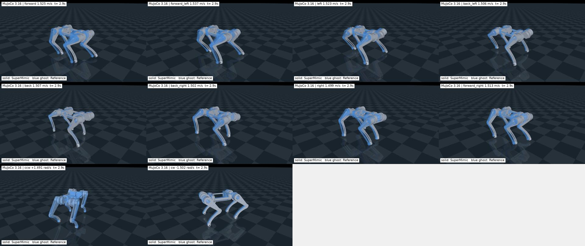

# RCDog-SuperMimic

自研 12 自由度四足机器人 **RCDog** 的全向运动策略，基于 [Motphys/Uni-SuperMimic](https://github.com/Motphys/Uni-SuperMimic) 的 SuperMimic 可微世界模型与目标条件策略。一份策略跟踪十段参考动作：八个平移方向合速度 **1.5 m/s**，原地左右旋转 **1.5 rad/s**。

训练使用 MJWarp（MuJoCo Warp）GPU 后端；评估、视频导出和实机部署包使用独立 CPU MuJoCo / ONNX Runtime。

[](docs/assets/rcdog/omni150_mujoco.mp4)

实体机器人由策略控制，蓝色半透明机器人为参考动作，两者保留各自全局位置。点击封面查看完整 MP4。

## 结果

`omni150` 权重 `results/omni150/ckpt_002500.pt` 在同一台 CPU 上完成的 10 次基准与 80 次初态扰动全部通过（`results/SIM2SIM_SUMMARY.json`，90/90）。

| 平移方向 | 目标合速度 | 实测合速度 |
| --- | --- | --- |
| 前进 | 1.5 m/s | 1.525 m/s |
| 左前 | 1.5 m/s | 1.537 m/s |
| 左移 | 1.5 m/s | 1.523 m/s |
| 左后 | 1.5 m/s | 1.506 m/s |
| 后退 | 1.5 m/s | 1.507 m/s |
| 右后 | 1.5 m/s | 1.502 m/s |
| 右移 | 1.5 m/s | 1.499 m/s |
| 右前 | 1.5 m/s | 1.513 m/s |
| 左转 | 1.5 rad/s | 1.491 rad/s |
| 右转 | 1.5 rad/s | −1.502 rad/s |

| 关节类别 | 90 次测试峰值速度 | 峰值扭矩 |
| --- | --- | --- |
| 髋 | 17.685 rad/s | 23.70 N·m |
| 大腿 | 17.365 rad/s | 23.70 N·m |
| 小腿 | 14.548 rad/s | 28.19 N·m |

小腿峰值速度达到设定上限 15.05 rad/s 的 96.7%，髋和大腿出现扭矩限幅。以上均为仿真结果，尚未在实机验证。

三档训练链的选中迭代与训练耗时：

| 阶段 | 平移 / 旋转 | 选中权重 | 迭代 | 训练耗时 |
| --- | --- | --- | --- | --- |
| omni050 | 0.5 m/s / 0.75 rad/s | `results/omni050/ckpt_001000.pt` | 1000 | 421.20 s |
| omni100 | 1.0 m/s / 1.00 rad/s | `results/omni100/ckpt_000500.pt` | 500 | 163.32 s |
| omni150 | 1.5 m/s / 1.50 rad/s | `results/omni150/ckpt_002500.pt` | 2500 | 940.62 s |

训练在单张 RTX 4090 24 GB 上完成，1024 个并行环境，世界模型 `[512,512,512]`，策略 `[512,256,128]`。耗时包含已有编译缓存；各档通过验收后即停止训练。

## 仓库结构

```text
RCDog-SuperMimic/
├── src/unisupermimic/
│   ├── rl/algos/supermimic/                 # 世界模型、策略、critic、replay 与 learner
│   ├── tasks/motion_tracking/rcdog/supermimic/
│   │   ├── robot.py, kinematics.py          # 12 关节顺序、默认姿态、PD 增益、前向运动学
│   │   ├── motion.py, mdp.py                # 参考动作加载、观测、奖励与终止
│   │   ├── motor_backend.py                 # 4 ms 电机 PD 与力矩限幅
│   │   ├── env.py, manager_terms.py         # 训练环境与 Manager terms
│   │   ├── evaluate.py, render.py           # 框架后端的评估与视频导出
│   │   └── registry.py                      # 任务注册
│   ├── conf/supermimic/task/rcdog_super_mimic/  # rcdog 任务配置（mjwarp / mujoco / motrix）
│   └── assets/
│       ├── robots/rcdog/                    # MJCF、网格、模型清单
│       └── motions/rcdog/                   # 生成的参考动作 CSV 与元数据
├── tools/rcdog/
│   ├── prepare_rcdog_assets.py              # URDF + 网格 → 带碰撞体的 MJCF
│   ├── generate_omni.py                     # 生成八方向与双向旋转参考
│   ├── train_pipeline.py                    # 分档训练、验收、框架复核
│   ├── evaluate_locomotion.py               # 独立 CPU MuJoCo 评估
│   ├── render_rollout.py                    # 已记录轨迹的视频导出
│   ├── validate_runtime.py                  # 张量契约、前向运动学与奖励梯度冒烟检查
│   ├── plan.json, plan_150.json             # 三档 / 单档训练配置
│   └── model_audit.json, standing_check.json
├── source/                                  # 源 URDF、STL 与 CAD 导出元数据
├── results/                                 # 三档权重、配置、逐动作评估与汇总
├── initial_policy/strafe025.pt              # 训练链起点权重
├── real_deploy/                             # 1.5 m/s 档 ONNX/TorchScript 与标定说明
├── docs/assets/rcdog/                       # 演示视频与封面
├── README.upstream.md, README.upstream_zh.md
└── LICENSE, NOTICE, THIRD_PARTY.md
```

## 安装

要求 Linux、Python 3.10–3.13 与 [uv](https://docs.astral.sh/uv/)。训练需要 CUDA GPU；评估和部署包验证只需要 CPU。以下命令均在仓库根目录执行。

```bash
git clone https://github.com/coolcooldiyang/RCDog-SuperMimic.git
cd RCDog-SuperMimic
uv sync
```

`uv sync` 按 `uv.lock` 安装 `unilab`、三个仿真后端、PyTorch 与开发依赖。依赖快照见 `requirements-tested-cloud.txt`（训练机）和 `tools/rcdog/requirements-local-sim2sim.txt`（本机 CPU 评估）。生成参考动作另需 SciPy：

```bash
uv pip install scipy
```

## 资产准备

仓库已包含转换后的 RCDog MJCF、网格和参考动作。要从源 URDF 重建：

```bash
uv run python tools/rcdog/prepare_rcdog_assets.py
uv run python tools/rcdog/generate_omni.py
```

`prepare_rcdog_assets.py` 读取 `source/robot.urdf` 与 `source/meshes/`，输出 `src/unisupermimic/assets/robots/rcdog/`；`generate_omni.py` 读取 `tools/rcdog/model_audit.json`，输出 0.5 / 1.0 / 1.5 m/s 三档、每档八方向加双向旋转的 CSV 与 `.json` 元数据。生成参数在 `generate_omni.py` 内按档定义，参考周期、占空比与抬脚高度见 `docs/OMNI150.md`。

`tools/rcdog/validate_runtime.py` 可检查前向运动学、观测维度和奖励梯度：

```bash
uv run python tools/rcdog/validate_runtime.py --backend mjwarp --num-envs 32
```

## 训练

完整三档训练链从 `initial_policy/strafe025.pt` 开始，依次训练 omni050、omni100、omni150。每档要全部动作通过评估和扰动测试才会停止当前训练并进入下一档：

```bash
CUDA_VISIBLE_DEVICES=0 uv run python tools/rcdog/train_pipeline.py
```

训练日志写入 `logs/`，checkpoint 写入 `runs/<stage>_v1/`，验收通过的权重和配置复制到 `results/<stage>/`，进度写入 `tools/rcdog/pipeline_status.json`。已有同名 run 时程序会拒绝覆盖。

只训练 1.5 m/s 一档时，以 `results/omni100/ckpt_000500.pt` 初始化：

```bash
CUDA_VISIBLE_DEVICES=0 uv run unisupermimic-train \
  task=rcdog_super_mimic/mjwarp \
  algo.num_envs=1024 algo.iterations=8000 \
  'algo.wm_hidden=[512,512,512]' \
  'algo.policy_hidden=[512,256,128]' \
  algo.wm_batch=1024 algo.pi_batch=1024 algo.wm_batches=10 \
  algo.wm_only_iters=250 algo.ckpt_every=500 algo.log_every=25 \
  +training.init_checkpoint=results/omni100/ckpt_000500.pt \
  'env.commands.motion.motion_files=[src/unisupermimic/assets/motions/rcdog/omni150_forward.csv,src/unisupermimic/assets/motions/rcdog/omni150_forward_left.csv,src/unisupermimic/assets/motions/rcdog/omni150_left.csv,src/unisupermimic/assets/motions/rcdog/omni150_back_left.csv,src/unisupermimic/assets/motions/rcdog/omni150_back.csv,src/unisupermimic/assets/motions/rcdog/omni150_back_right.csv,src/unisupermimic/assets/motions/rcdog/omni150_right.csv,src/unisupermimic/assets/motions/rcdog/omni150_forward_right.csv,src/unisupermimic/assets/motions/rcdog/omni150_ccw.csv,src/unisupermimic/assets/motions/rcdog/omni150_cw.csv]' \
  training.log_dir=runs/omni150_v1
```

`+training.init_checkpoint` 只加载网络权重，世界模型的经验与优化器状态重新建立。继续同一个 run 时改用 `algo.resume=true`、`algo.load_run` 和 `algo.checkpoint`，并让 `algo.iterations` 表示该阶段的总迭代数；续训不要再传 `init_checkpoint`。

## 评估

独立 CPU MuJoCo 评估从每段参考的第一帧开始，不设置根部轨迹、不施加辅助力。十条参考各跑一次：

```bash
uv run python tools/rcdog/evaluate_locomotion.py \
  --stage omni150 \
  --ckpt results/omni150/ckpt_002500.pt \
  --output results/omni150/recheck.json
```

加 8 次初态扰动（关节角 ±0.01 rad、根部 XY ±0.005 m、线速度 ±0.03 m/s、角速度 ±0.05 rad/s）：

```bash
uv run python tools/rcdog/evaluate_locomotion.py \
  --stage omni150 \
  --ckpt results/omni150/ckpt_002500.pt \
  --output results/omni150/recheck_trials.json \
  --trials 8 --noise 0.01
```

输出 JSON 汇总速度、位移、对角触地相位、抬脚、漂移、非足部触地和子步关节速度；逐动作明细与轨迹 NPZ 写在输出文件同目录。`results/omni150/` 中保存了发布时的验收结果，轨迹 NPZ 未纳入仓库，可用上面的命令重新生成。

## 视频导出

`render_rollout.py` 渲染已记录的轨迹，实体为策略实际状态，蓝色半透明为参考：

```bash
uv run python tools/rcdog/render_rollout.py \
  --rollout results/omni150/recheck_omni150_forward_seed101.npz \
  --reference src/unisupermimic/assets/motions/rcdog/omni150_forward.csv \
  --output docs/assets/rcdog/omni150_forward.mp4 \
  --label omni150_forward
```

## 实机部署包

`real_deploy/bundle_omni150/` 提供 1.5 m/s 档的 `actor_fp32.onnx`、`actor_fp32.ts`、十段参考的 `references/*.npz`、固定输入 `golden_inputs.npz` 和导出误差记录。策略输入为 `(1,10,48)` 观测历史与 `(1,390)` 未来参考，输出 `(1,12)` 关节偏移；网络内已包含训练得到的归一化参数。

离线核对：

```bash
python real_deploy/verify_bundle.py --bundle real_deploy/bundle_omni150
```

接口字段、标定顺序和限制见 [real_deploy/README.md](real_deploy/README.md) 与 [real_deploy/CALIBRATION_AND_INTERFACE.md](real_deploy/CALIBRATION_AND_INTERFACE.md)。**实机电机通信控制程序未包含在本仓库中；这批文件没有在实机上使能或验证过。**

## 来源与许可

- 框架与算法：[Motphys/Uni-SuperMimic](https://github.com/Motphys/Uni-SuperMimic)（Apache-2.0），原始方法为 [SuperMimic](https://supermimic.github.io/)（[论文](https://arxiv.org/abs/2610.28480)）。
- RCDog 机器人模型由项目作者提供；参考动作由本仓库脚本生成；训练权重由本项目训练得到。
- 本发布版的组合软件按 GPL-3.0-only 分发，上游 Apache-2.0 与 MIT 通知保留。详见 [THIRD_PARTY.md](THIRD_PARTY.md) 与 [NOTICE](NOTICE)。
